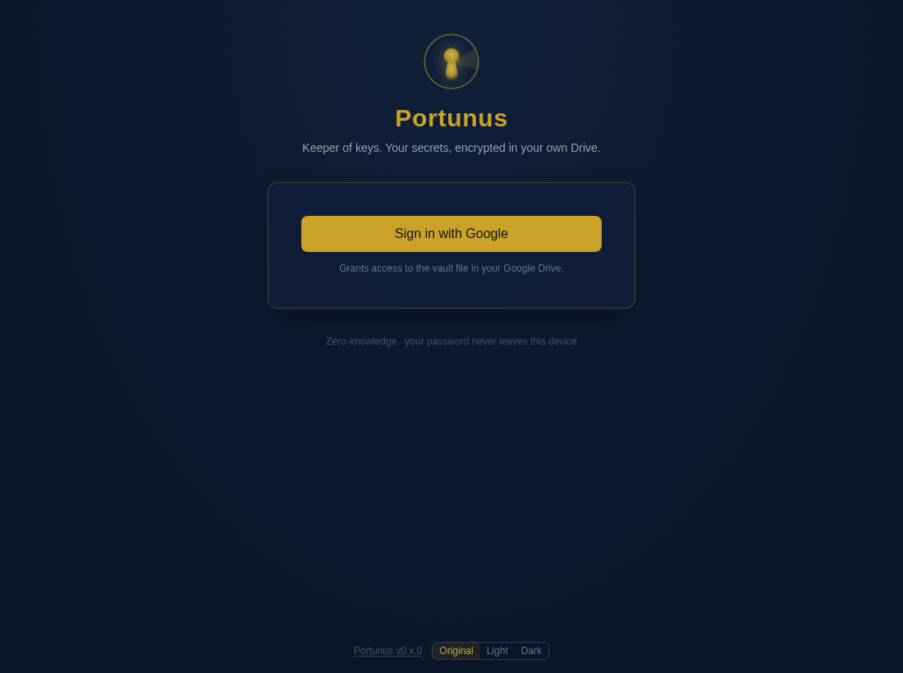

# Portunus

**Self-hosted, stateless, zero-knowledge secrets manager backed by your own Google Drive.**

Named after Portunus, the Roman god of keys, doors, and harbors.

Your secrets are encrypted **in your browser** — before anything touches the
network — and stored as a single file (`portunus.vault.json`) in your Google
Drive. The server brokers OAuth and proxies Drive calls; it never sees
plaintext, your master password, or your keyfile. No database, one stateless Docker
image.

<!-- TODO: replace with a screenshot or short screen recording (GIF) -->


## Features

- **Zero-knowledge server** — Argon2id + XChaCha20-Poly1305, all client-side
- **Password *and* keyfile required** — `KEK = Argon2id(password ‖ keyfile)`.
  A leaked password alone can't brute-force the vault; neither can the
  keyfile alone.
- **Per-device keyfile** — install in the browser or load per-session;
  Crockford-Base32 recovery code at creation
- **Google Drive storage** — the vault lives in a `Portunus Application`
  folder in your Drive; the app only ever sees files it created
  (`drive.file` scope)
- **Password manager UX** — search, quick-copy, entry editor (username /
  email / password / URL / notes), password generator
- **Auto-lock** — visible countdown, pauses while you have unsaved changes;
  activity (mouse, keys, scroll) resets it
- **Save protection** — re-enter your master password to save; conflict
  detection on concurrent writes
- **Single Docker image** — Next.js standalone build, non-root, ~stateless

## Screenshots

<!-- TODO: capture these — see the checklist at the bottom of this file -->

| Vault creation — recovery code + keyfile download | Unlock — keyfile + password |
|---|---|
|  |  |

| Unlocked vault — entry list & search | Expanded entry — edit fields |
|---|---|
|  |  |

## Quick start (Docker Compose)

The fastest way to run Portunus is Docker Compose. Fill in the environment
values below (see [Configuration](#configuration)), then:

```yaml
# docker-compose.yml
services:
  portunus:
    image: ghcr.io/ralphv/portunus:latest
    ports:
      - "3000:3000"
    environment:
      AUTH_GOOGLE_ID: "your-google-client-id"
      AUTH_GOOGLE_SECRET: "your-google-client-secret"
      AUTH_SECRET: "generate-with-openssl-rand-hex-32"
      AUTH_URL: "http://localhost:3000"     # public origin when deployed
    restart: unless-stopped
```

> **Note:** if you keep this compose file inside a git repo, don't commit the
> real secret values — keep a placeholder version tracked, or use
> `env_file: .env` (gitignored) instead.

```bash
docker compose up -d
```

Then open `http://localhost:3000`.

### Building the image yourself

```bash
docker build -t portunus:latest .
# or: npm run docker:build
```

To run on a remote server, export and load:

```bash
docker save portunus:latest | gzip > portunus.tar.gz   # or: npm run docker:save
# copy to the server, then:
gunzip -c portunus.tar.gz | docker load
docker compose up -d                                  # compose file above, minus `build:`
```

## Configuration

Copy `.env.example` to `.env` (or `.env.local` for dev) and fill in:

| Variable | Required | Description |
|---|---|---|
| `AUTH_GOOGLE_ID` | yes | Google OAuth client ID |
| `AUTH_GOOGLE_SECRET` | yes | Google OAuth client secret |
| `AUTH_SECRET` | yes | Session encryption secret — `openssl rand -hex 32` |
| `AUTH_URL` | yes | Public origin, e.g. `https://vault.example.com` |

**The server refuses to start if any of these are missing.**

### Google OAuth setup (required once, per self-hoster)

1. Google Cloud Console → create a project → enable the **Google Drive API**
2. APIs & Services → OAuth consent screen → configure (External is fine for
   personal use; add yourself as a test user)
3. Credentials → Create OAuth client ID → **Web application**
4. Authorized redirect URI: `http://localhost:3000/api/auth/callback/google`
   — plus `https://your-domain/api/auth/callback/google` when deployed
5. Copy the client ID/secret into your env file

The app requests only the `drive.file` scope — it can see just the files it
created, never the rest of your Drive.

## Deploying

- **`AUTH_URL` must match the public origin** — it drives OAuth callback
  URLs and cookie flags.
- **Serve it over HTTPS** (reverse proxy: Caddy, nginx, Traefik). The unlock
  flow uses WebCrypto, which browsers only allow in secure contexts — plain
  `http://` on a LAN will not work. The container itself speaks HTTP on
  port 3000; terminate TLS at the proxy.

## Security model

```
vault plaintext ──▶ XChaCha20-Poly1305 (random data key)
                        │
data key ──▶ wrapped by KEK = Argon2id(password ‖ keyfile_bytes)
                        │
envelope (ciphertext + wrapped key + kdf params) ──▶ Google Drive
```

- Argon2id parameters follow OWASP guidance (19 MiB, t=2, p=1)
- Header fields are bound as AEAD additional data — tampering with KDF
  params or the engine id fails decryption
- Per-save random nonces; envelope encryption allows engine rotation
- Unlock requires **both** the master password and the keyfile

> **Keep your `portunus.key` file and recovery code safe.** The keyfile is
> per-device — losing all copies *and* the recovery code means the vault is
> unrecoverable. There is no password reset; that's the point.

## Development

```bash
npm install
npm run dev          # dev server (needs .env.local)

npm test             # vitest — crypto, Drive client, vault session
npm run lint         # eslint
npm run build        # production build (standalone output)
```

Devin environment setup is committed in `.devin/blueprint.yaml`; update it
alongside any changes to these commands.

Stack: Next.js 16 (App Router), TypeScript strict, Tailwind v4, Auth.js v5,
`hash-wasm` (Argon2id), `libsodium-wrappers` (XChaCha20-Poly1305).

## Contributing

Issues and PRs welcome. Please don't post vault contents, keyfiles, or
recovery codes in issues — and never commit `*.key` or `.env*` files (both
are gitignored).

## License

[AGPL-3.0](LICENSE) — self-host it, fork it, but if you offer a modified
version as a hosted service you must share the source.
