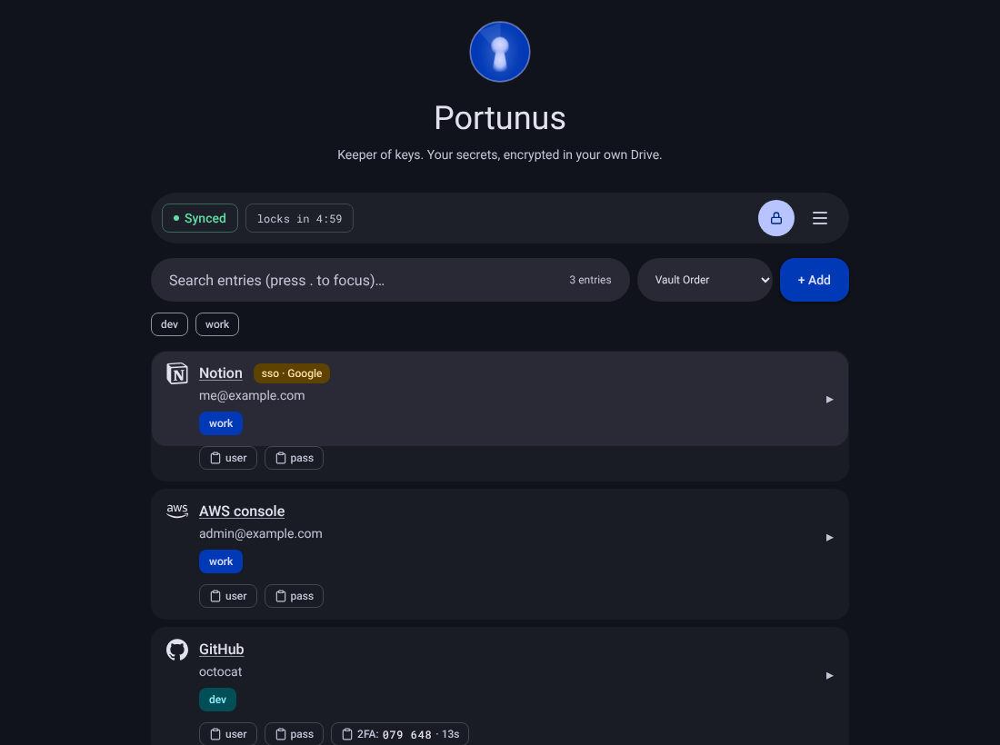
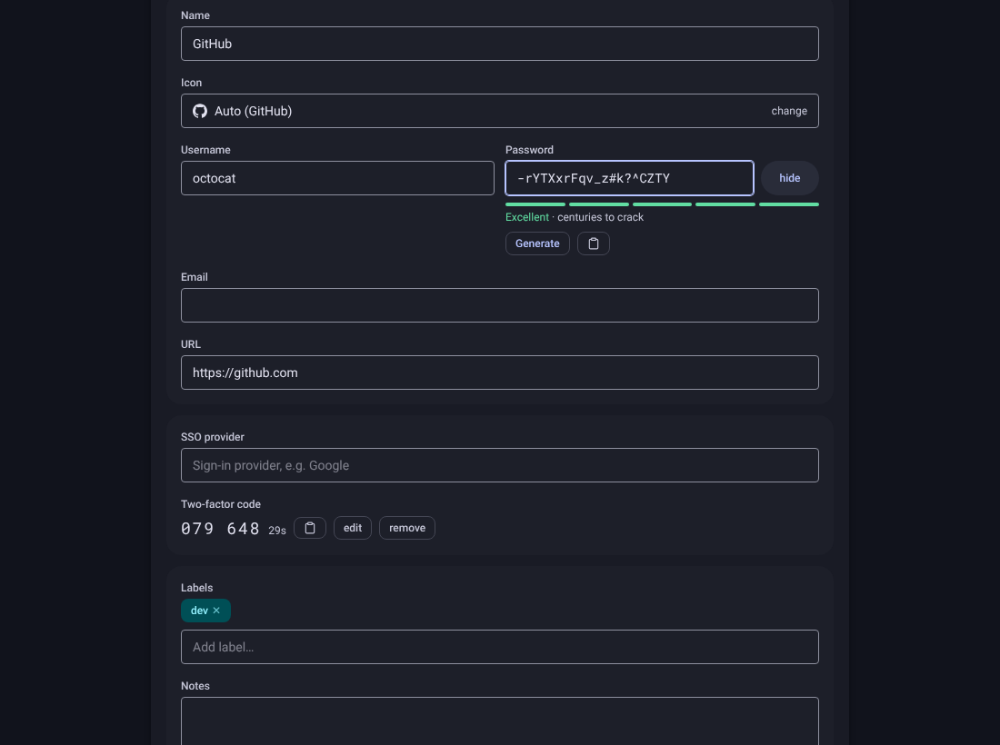
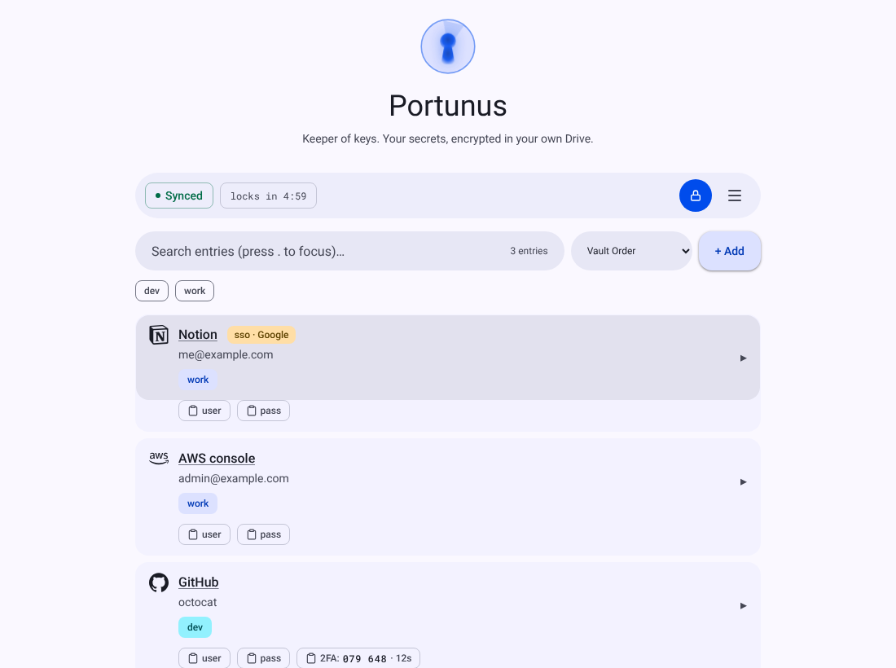

# Features

A tour of what Portunus does today. The complete, authoritative list is
README's [Features](https://github.com/ralphv/portunus/blob/main/README.md#features)
section; this page groups it by what you'd want to know.

## Encryption and unlocking

- **Zero-knowledge server.** Argon2id + XChaCha20-Poly1305, all in your
  browser. The server never sees plaintext, your master password, or your
  keyfile. See the [Security model](./security).
- **Password *and* keyfile.** `KEK = Argon2id(password ‖ keyfile)`: a leaked
  password alone can't brute-force the vault, and neither can the keyfile
  alone. The keyfile can be installed in the browser per device or loaded
  per session, and a Crockford-Base32 recovery code is shown once at
  creation.
- **Show/hide and an on-screen keyboard.** Every password field has an eye
  button. The unlock field also has an optional on-screen keyboard whose keys
  are shuffled each time it opens, so a keylogger sees no keystrokes and
  click positions alone don't give the password away.
- **Biometric unlock (optional).** With `PORTUNUS_BIOMETRIC_UNLOCK=1`, a phone
  or laptop can unlock with its fingerprint, face or screen lock (WebAuthn
  passkey + PRF). The keyfile is still required and the master password is
  never stored. See [Biometric unlock](./configuration#biometric-unlock).
- **Two-factor vault delivery (optional).** Turn it on from Security and the
  server asks for a fresh authenticator code on every unlock before it sends
  the vault to a browser. See
  [Two-factor vault delivery](./configuration#two-factor-vault-delivery).
- **Vault isolated in a Web Worker.** The keys and decrypted vault live in a
  dedicated Worker. The page only holds names, usernames, URLs and other
  non-secret fields, and asks the Worker for a password or TOTP seed only
  when you reveal, edit or copy it. Locking terminates the Worker.

## Storage and integrity

- **Your own Google Drive.** The vault is one ciphertext file,
  `portunus.vault.json`, in a `Portunus Application` folder. The `drive.file`
  scope means the app only sees files it created.
- **Tamper-detected vault file.** The server signs every save with Ed25519,
  bound to that Drive file's id, and refuses to serve a file whose signature
  is missing, wrong, or made for a different file. See
  [Vault signatures](./configuration#vault-signatures).
- **Offline mode.** The vault opens read-only from a cached ciphertext and
  recovers by itself when connectivity returns.
- **Save protection.** Saving asks for your master password again, and
  concurrent writes are detected. The Save button only appears once there are
  unsaved changes.

## Everyday password manager

- **Search and labels.** Multi-term search (press `.` to jump to it),
  colour-coded labels with one-click filters, and a label input that lists
  every existing label as tap-to-add chips.
- **Sorting.** Vault order, name A–Z / Z–A, oldest/newest first, or
  oldest/newest password. Display only, remembered per device.
- **Entry editor.** Username, email, password, URL, notes, and an SSO
  provider field that marks accounts signed in via SSO with an
  `sso · provider` chip. Quick-copy buttons on the collapsed row.
- **Password generator and strength meter.** zxcvbn scoring with a
  crack-time estimate under every password field.
- **Two-factor codes (TOTP).** Paste a secret or `otpauth://` URI, or scan
  the QR setup image. Live codes with a countdown, copyable from the editor
  and the collapsed row.
- **Site icons.** About 260 bundled brand logos, matched from the entry's URL
  or name with nothing leaving the browser. Logos are drawn in their brand
  colour, unmatched entries get a coloured letter monogram, and each icon can
  be overridden from a searchable picker.
- **Service name autocomplete.** "Net" completes to "Netflix" (Tab to
  accept), and fills in the URL when it's empty.
- **Duplicate and whitespace warnings.** A "duplicate?" hint when a new entry
  is for the same site and reuses an existing username or email; stray
  leading/trailing spaces are highlighted with a one-click trim.
- **Entry history.** Created/updated timestamps, update count, and the last
  5 previous passwords.
- **Have I Been Pwned checks.** An opt-in k-anonymity audit from the menu,
  plus an automatic check when you edit a password. Only the first 5
  characters of the SHA-1 hash leave the browser. See
  [Have I Been Pwned checks](./configuration#have-i-been-pwned-checks).
- **Secrets rendered on demand.** Passwords show as a fixed-length mask with
  no `<input>` holding them until you edit or "show", and re-mask when you
  click away, switch tabs, or after 30 s idle.
- **Focus mode.** Shows only the entry you're editing or adding until you
  press Done or Delete (on by default).
- **Synced settings.** Per-vault preferences (on-edit breach check, browser
  autofill suppression, Focus mode) are stored inside the encrypted document,
  so they follow you across devices.
- **Auto-lock.** A visible countdown that pauses while you have unsaved
  changes; mouse, keys and scroll reset it. The lock button next to Save
  locks right away.

## Look and feel

- **Material 3 design** with a light and a dark colour scheme. System (the
  default) follows your device's setting, or pick Light or Dark; the choice is
  remembered per browser.
- Each label keeps one colour everywhere, letter avatars are coloured per
  name, and brand icons are toned for contrast in both schemes.

## Hardening

- **Strict Content-Security-Policy**: `script-src 'self'` with a per-request
  nonce and build-time hashes, no `'unsafe-inline'`/`'unsafe-eval'`,
  `frame-ancestors 'none'`, plus `nosniff`, `no-referrer`, a restrictive
  `Permissions-Policy`, and HSTS over HTTPS.
- **Script tamper-evidence (best effort).** Any `<script>` the build didn't
  emit shows an "Unexpected script detected" banner. See
  [Script injection](./security#script-injection).
- **One stateless Docker image.** Next.js standalone build, non-root, no
  database. See [Install](./install).
